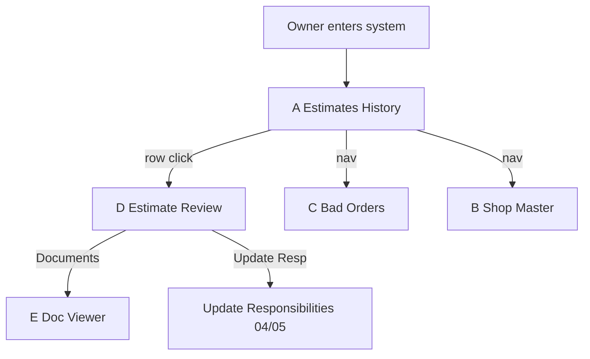
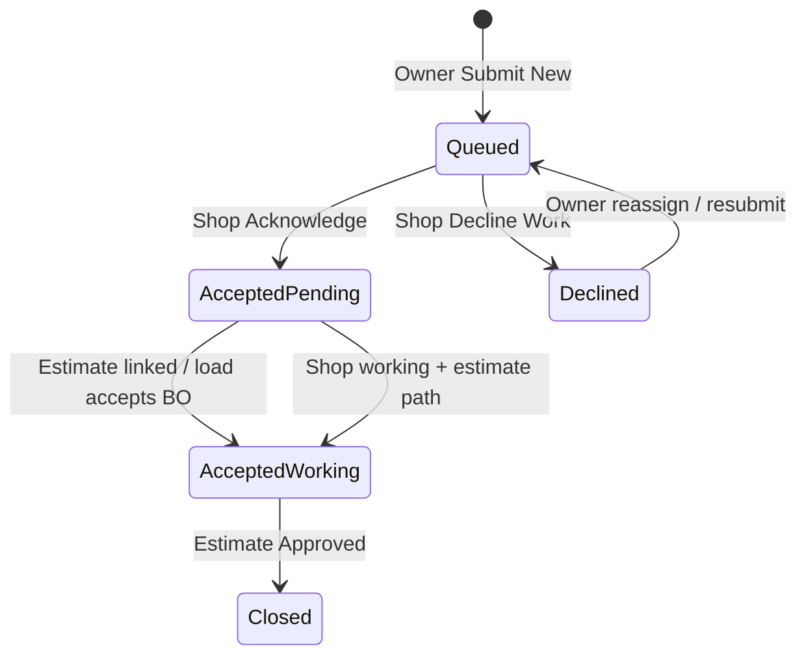
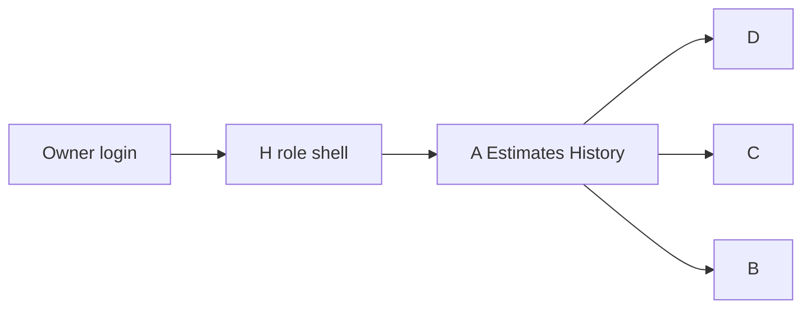

# Owner UI Spec — RLMS Repair Module (Step 1)

**Status:** Step 1 — **spec only**. No feature build until Bruce approves.  
**Base tip:** `f4e65cc` (`f4e65cc1fe96aa2cb1349229b2fe0462176f7463`)  
**Date:** 2026-10-14  
**Authoring context:** Owner UI **RESET** ordered by Bruce. Stop adding features; this document is the approval gate for Step 2.

**Delivery rules (unchanged):** integer cents; local Postgres only; no hard deletes (VOIDED / soft-delete only); draft PR only; no merge/deploy; no Supabase branch; no paid services; **bundles only** → Bruce pulls at `C:\Users\BruceHarbridge\rlms-push`. Never push `RESIDCO/RLMS` via GitHub MCP or any cloud path.

**Screenshot attachment status:** Files named `01-estimates-history`, `02-estimate-review`, `03-file-attachments`, `04-update-responsibilities`, `05-responsibility-codes`, `06-bad-orders` were **not** in the Project store, uploads, or capture artifacts when this spec was written. Wireframes below are structured for Bruce to mark gaps when screenshots attach. Mapping sources until then: [`Manual_Gap_Review.md`](../Manual_Gap_Review.md) (RS pages cited), Phase 1 build brief, Railinc App. G reference, and current tip `f4e65cc` UI field sets. **Do not invent unmarked AAR shopping-reason / BO-rule lists.**

---

## 0. Goals of the reset

1. Owner/reviewer landing is an **actionable Estimates History** grid (not a BO-first form).
2. **Shop master** is owner-created and permanent; dropdown empty until shops exist. Billing roads are a separate table — not the shop list.
3. **Bad Order** is a structured three-part page matching repairSMART (search + New BO + BO History). Multi-car, VCF, shop from master, documents, distribution list only.
4. **Estimate Review** is owner-action-only (no shop “Submit for approval”; owner does not set completed/outbound dates).
5. **Documents** open in a dedicated viewer (new window/tab); delete → **VOIDED**.
6. **Lessee** mirrors Estimate Review layout, read-only except own-line approve/dispute.
7. **Railinc 500-byte validation** rejects with per-field errors and keeps rejects in history.
8. Owner role entering the system always sees **Screen A** first.

---

## 1. Roles and routes

| Role | Login | Primary entry | Key routes |
|---|---|---|---|
| **Owner / reviewer** (Bruce, fleet/mech managers) | RLMS auth | Screen **A** `/#/repair` | A–E, G, H; shop master B; BO C |
| **Shop** | None (event link) | `/#/repair/e/:token` | Accept/decline, arrival, estimate upload, POD/complete, invoice, docs |
| **Lessee** | None (lessee link) | `/#/repair/lessee/:token` | Screen **F** — own responsibility lines only |

---

## 2. End-to-end flow by role

### 2.1 Owner / reviewer (Bruce)

| Step | Who | Screen | Buttons / actions | Resulting status |
|---|---|---|---|---|
| 1 | Owner | **H → A** Landing Estimates grid | (auto) | Sees only estimates needing owner action by default |
| 2 | Owner | **B** Shop master | Create shop / edit / deactivate | Shop available in BO + estimate filters; never hard-deleted |
| 3 | Owner | **C** Bad Order | Fill New BO → **Submit New** | BO **Queued**; shop + owner notified (distribution list); no Estimate ID |
| 4 | Shop | Shop link | Acknowledge | BO **Accepted-Pending** |
| 5 | Shop | Shop link | Arrival date | Yard arrival set (required before shop Submit for Approval on estimate) |
| 6 | Shop | Shop link | Upload 500-byte (+ optional docs) | Estimate **Queued** (shop-only); BO → **Accepted-Working** when estimate linked |
| 7 | Shop | Shop link / shop history | **Submit for Approval** | Estimate **Awaiting Approval** (now visible on A) |
| 8 | Owner | **A** → row → **D** Estimate Review | Review lines; optional pencil header; **Update Responsibilities**; **Review & Compare**; **Documents** → **E** | Still Awaiting Approval (or Adjustment for Approval) |
| 9a | Owner | **D** | **Approve** | Estimate **Approved**; BO closes when estimate approved (RS); shop notified |
| 9b | Owner | **D** | **Request Revision** | Estimate **Revision Requested**; shop notified |
| 9c | Owner | **D** / bulk **A** | Approve terminate (when Awaiting Terminate) | **Terminated** or remain open per decision |
| 10 | Shop | Shop link | POD / completed (outbound) date | Estimate **Completed** *(shop sets outbound — not owner on D)* |
| 11 | Owner | **A** / close helpers | Ready-to-Close → Close (after invoice match + dispo) | Event **CLOSED** (audited; no auto-close) |

**Removed from owner Estimate Review (D):** **Submit for approval**; setting **completed / outbound** date.

### 2.2 Shop (no login)

| Step | Who | Screen | Buttons / actions | Resulting status |
|---|---|---|---|---|
| 1 | Shop | Event link | Open link from email | Sees next action for event |
| 2 | Shop | Event link | **Acknowledge** / **Decline Work** (+ reason) | BO **Accepted-Pending** or Declined (reassign) |
| 3 | Shop | Event link | Enter **Arrival Date** | On-hand / yard arrival recorded |
| 4 | Shop | Event link | Upload estimate (500-byte); pick BO | Estimate **Queued**; BO **Accepted-Working** |
| 5 | Shop | Event link / Queued grid | Edit via **re-upload only** (MG1); **Submit for Approval** (Yard Arrival required) | **Awaiting Approval** |
| 6 | Shop | Event link | On Revision Requested: re-upload | Back to **Awaiting Approval** |
| 7 | Shop | Event link | POD/ERD; **Completed date**; invoice upload; docs | Estimate **Completed** when outbound set; invoice MATCHED/MISMATCH via pre-pay |
| 8 | Shop | Event link | Soft-delete Queued estimate | **Awaiting Delete** → owner → **VOIDED** (never purge) |

### 2.3 Lessee (no login)

| Step | Who | Screen | Buttons / actions | Resulting status |
|---|---|---|---|---|
| 1 | System | — | Owner/reviewer sends Resp 6 email with lessee link | Lessee notified (shop **never** CC’d) |
| 2 | Lessee | **F** | View same layout as D (header, all lines, totals, attachments) | Read-only except own lines |
| 3 | Lessee | **F** | **Approve** / **Dispute** on own responsibility lines (Resp 6) | Append-only `lessee_approvals`; reviewers notified |
| 4 | Lessee | Email reply (secondary) | Reply to tokenized address | Parsed decision; **reviewer confirms** before effect |

---

## 3. Screens A–H (wireframes + field maps)

Legend for screenshot map columns: **RS** = Manual_Gap / repairSMART manual; **Tip** = present on tip `f4e65cc`; **Shot** = Bruce screenshot id (mark when attached).

---

### A. Landing — Estimates History `/#/repair`

**Intent:** Actionable work queue. Owner entering the system lands here (**H**).

**Default filter:** only estimates needing owner action:

- Awaiting Approval  
- Revision Requested  
- Adjustment for Approval  
- Awaiting Terminate  

**Hidden unless filtered in:** Approved, Completed, Terminated, Queued (shop-only), VOIDED, etc.

#### ASCII wireframe

```
┌──────────────────────────────────────────────────────────────────────────────┐
│  RLMS Repair · Estimates History                              [User · Role]  │
├──────────────────────────────────────────────────────────────────────────────┤
│  Views: [Default action queue ▼] [Save view] [Manage views]                  │
│  Filters: Shop [  ] Initials [  ] Number [  ] Status [multi ▼] Date [..–..] │
│           Date field [Yard Arrival ▼]   [Clear] [Apply]                      │
│  Group by: [None ▼]   Sort: [Status, Arrival…]   Page size [50 ▼]            │
├──────────────────────────────────────────────────────────────────────────────┤
│  SUMMARY                                                                     │
│  Estimates: n   Cars: n   Clients/shops: n                                   │
│  Total $: …   $/est: …   $/car: …   $/client: …     (updates with filters)   │
├──────────────────────────────────────────────────────────────────────────────┤
│  Bulk: [Approve] [Get BRC] [Export Excel] [Export 500-byte] [Validate…]     │
│  ☑ select-all                                                                │
│  ┌──┬──────┬────┬──────┬─────┬────────┬────────┬─────┬──────┬──────┬──────┐ │
│  │☑ │Issue?│Att │Shop  │Init │Number  │Status  │Arriv│Appr  │Tot $ │Wreck?│ │
│  ├──┼──────┼────┼──────┼─────┼────────┼────────┼─────┼──────┼──────┼──────┤ │
│  │  │ …    │ 📎 │ APA… │OFOX │528313  │Await.. │ …   │  —   │36,7..│  N   │ │
│  └──┴──────┴────┴──────┴─────┴────────┴────────┴─────┴──────┴──────┴──────┘ │
│  ◄ 1 2 3 … ►                                                                 │
└──────────────────────────────────────────────────────────────────────────────┘
```

#### Grid capabilities (required)

| Capability | Spec |
|---|---|
| Saved customizable views | Column set, filters, sort, group-by; named views per user |
| Sort / filter / group-by | Per-column; multi-status; shop / initials / number / date |
| Paging | Items per page + page controls |
| Excel export | Export **grid as shown** (filtered/sorted view) |
| Bulk Approve | Selected rows in approvable statuses → **Approved** |
| Bulk Get BRC | Export BRC detail for selection (Excel / PDF / CSV / 500-byte as available) |
| Summary box | Estimate count, total cost, $/estimate, car count, $/car, client count, $/client |

#### Column map (awaiting shot `01-estimates-history`)

Exact order/labels to be confirmed against screenshot **01**. Until then, map from RS p.11–14 + build brief §10:

| # | Column (proposed label) | Source | Shot 01 |
|---|---|---|---|
| 1 | Select (checkbox) | Bulk actions | ☐ |
| 2 | Issues? | RS #1, #16 | ☐ |
| 3 | Attachments (count/icon) | RS #12, #16 | ☐ |
| 4 | Shop (Name – City, ST) | Shop master B | ☐ |
| 5 | Car Initials | RS #16 | ☐ |
| 6 | Car Number | RS #16 | ☐ |
| 7 | Mark / Billing road | RS #16 | ☐ |
| 8 | Status | Status set RS #5 | ☐ |
| 9 | Yard Arrival | RS #16 | ☐ |
| 10 | Approved date | RS #16 | ☐ |
| 11 | Outbound / Completed | RS #13, #16 | ☐ |
| 12 | Target Outbound | RS #13 | ☐ |
| 13 | Created | RS #16 | ☐ |
| 14 | Terminated | RS #16 | ☐ |
| 15 | Total $ (cents→display) | Summary / BRC | ☐ |
| 16 | Wreck? | RS #16 | ☐ |
| 17 | Client / assignment | RS filters | ☐ |

Row click → **D** Estimate Review. Attachment icon may deep-link **E**.

#### Mermaid — owner queue



---

### B. Shop master (new)

**Route:** `/#/repair/shops` (or modal/panel from Repair nav).  
**Rule:** Shop dropdowns elsewhere are **EMPTY until at least one shop is created.** Do **not** seed the shop list from the payee / billing-road spreadsheet as selectable shops. Billing roads remain a separate lookup; validate optional mark/billing road against that table. Remove duplicate / non-shop seed entries that currently pollute the shop list.

#### ASCII wireframe

```
┌─────────────────────────────────────────────────────────────┐
│  Shop Master                                    [+ New Shop] │
├─────────────────────────────────────────────────────────────┤
│  Filter: [active only ☑] [search………………]                     │
│  ┌────────────────┬──────────┬─────┬──────┬──────┬────────┐ │
│  │ Legal name     │ City     │ ST  │ SPLC │ Mark │ Active │ │
│  ├────────────────┼──────────┼─────┼──────┼──────┼────────┤ │
│  │ (empty state: “No shops yet — create one”)               │ │
│  └────────────────┴──────────┴─────┴──────┴──────┴────────┘ │
├─────────────────────────────────────────────────────────────┤
│  Create / Edit Shop                                         │
│  Legal name *     [____________________]                    │
│  City *           [________]  State * [__]                  │
│  SPLC *           [______]                                  │
│  Mark / billing road (optional) [____]  ← validate vs       │
│                                billing-road table           │
│  Contacts: name / email / phone (1..n)                      │
│  Active ☑                                                   │
│  [Cancel]  [Save]                                           │
│  Deactivate never deletes. Linked to owner/tenant.          │
└─────────────────────────────────────────────────────────────┘
```

| Field | Required | Notes |
|---|---|---|
| Legal name | Yes | Display + “Name – City, ST” |
| City, State | Yes | |
| SPLC | Yes | Location |
| Mark / billing road | Optional | Validate against billing-road table if provided |
| Contacts | ≥0 | Contact bank linkage |
| Active | Yes | Deactivate hides from dropdowns; **never hard-delete** |

**Display format everywhere:** `Name – City, ST`.

---

### C. Bad Order — match shot `06-bad-orders` (addendum)

**Route:** `/#/repair/bad-orders` (also reachable from nav; **not** the post-reset landing).  
**One page, three parts.** No Estimate ID on BO create. Rename any “Event id – Ready to close” control elsewhere to **DDCT Event ID** where it refers to DDCT (close helpers stay event-scoped but labels must not confuse BO with estimate IDs).

**Screenshot:** awaiting `06-bad-orders` — layout below follows Bruce’s addendum exactly; mark gaps when shot attaches.

#### C1. Search bar (top)

| Control | Behavior |
|---|---|
| Shops | Multi/select from **shop master** (empty until shops created) |
| Statuses | Multi-select; **default:** Queued, Accepted-Pending, Accepted-Working |
| Initials | Car initials |
| Number | Car number |
| Date Range | From–to |
| Date Range Filter | Which date field the range applies to (B/O date, arrival, incident, …) |

#### C2. “New Bad Order” entry panel

```
┌─ Search ────────────────────────────────────────────────────┐
│ Shops [▼] Statuses [Queued; Accepted-Pending; Accepted-…▼] │
│ Initials [    ] Number [      ] Date Range [  –  ]         │
│ Date Range Filter [B/O Date ▼]              [Search]       │
├─ New Bad Order ─────────────────────────────────────────────┤
│ Car Initials [____]  Car Number [______]  ☑ Multi Car      │
│   (when Multi Car: paste/type/upload list → several cars     │
│    on one BO / one BO per car per RS #7 — confirm vs shot)   │
│ Reporting Road [____]  D/C Road [____]  STCC [▼]           │
│ Dest. City [______] State [__]  Routing [____________]     │
│ Status [Queued] (read-only)     Arrival Date [________]    │
│ Reason [Bad Order Reason list ▼] + Other / keyed detail    │
│ Last Contents [________]  Car Load (○ Empty ● Loaded)      │
│ Cleaned [ ]  Travel On Own Wheels [ ]                      │
│ B/O Date [today]  B/O City [____] ST [__]                  │
│ Incident Date [____]  Incident ID / DDCT Event ID [____]   │
│ Comments [_________________________________________]       │
│ Shop [Name – City, ST ▼]  ← shop master only               │
│ Billing road (optional) [____]  validate vs billing-road   │
│ ☑ Allow Duplicates   (else block duplicate open BO / car)  │
│ Docs: 📎 “No New Bad Order Documents” / “N documents”      │
│      categories: SDS, scope, photos, … (RS #12 allowlist)  │
│ Distribution list only (no Resp 6 / lessee fields on BO)   │
│ [Cancel / Reset Form]                     [Submit New]     │
├─ Bad Order History ─────────────────────────────────────────┤
│ (grid — see C3)                                             │
└─────────────────────────────────────────────────────────────┘
```

| Field | Notes | Shot 06 |
|---|---|---|
| Car Initials / Number | VCF validate on submit | ☐ |
| Multi Car | Type / paste / upload list; blank initials → header initials (RS #7) | ☐ |
| Reporting Road, D/C Road | | ☐ |
| STCC | Dropdown | ☐ |
| Dest. City/State, Routing | | ☐ |
| Status | Read-only on create (Queued) | ☐ |
| Arrival Date | May be empty until shop enters | ☐ |
| Reason | Owner-managed **Bad Order Reason** list (not “BO rule” label) + **Other** + keyed detail for rule-based | ☐ |
| Last Contents, Car Load, Cleaned, Travel On Own Wheels | | ☐ |
| B/O Date, B/O City/State | Date defaults today; City/State required (RS #6) | ☐ |
| Incident Date, Incident ID | DDCT Incident ID / **DDCT Event ID** naming | ☐ |
| Comments | Free text | ☐ |
| Shop | From **B** shop master only | ☐ |
| Billing road | Optional; ≠ shop list | ☐ |
| Allow Duplicates | If unchecked, block second open BO on same car | ☐ |
| BO Documents | Link/icon; categories; delete → VOIDED | ☐ |
| Distribution list | Notification recipients only | ☐ |

**Buttons:** Cancel/Reset Form; Submit New.

**Do not invent** full AAR shopping-reason lists. Seed only known reasons already decided; admins add via owner-managed list. Tip `f4e65cc` seeded RULE_1 / RULE_107 / OTHER — rename UX to **Bad Order Reason**; keep admin extensibility.

#### C3. Bad Order History grid

| Column | Notes | Shot 06 |
|---|---|---|
| Shop (Name – City, ST) | From master | ☐ |
| Car Initials | | ☐ |
| Car Number | | ☐ |
| Attachments icon | Count; open **E** | ☐ |
| Bad Order date | | ☐ |
| Bad Order Reason | | ☐ |
| Destination City | | ☐ |
| State | | ☐ |
| Status | See transitions | ☐ |
| Yard Arrival | | ☐ |
| Estimate | Linked once one exists (open **D**) | ☐ |
| Wreck Est | | ☐ |
| Is Wreck? | | ☐ |
| Wheel Travel | Travel on own wheels | ☐ |
| STCC | | ☐ |
| Incident Date | | ☐ |
| Assignment (lessee – lease) | From cars_ref / assignment | ☐ |

**Grid chrome:** paging, items per page, Export Grid, group-by, Create Filter, sort/filter per column.

#### C4. BO status transitions



| Status | Meaning | Who moves |
|---|---|---|
| **Queued** | Created; waiting on shop | Owner create |
| **Accepted-Pending** | Shop acknowledged; no estimate linked yet | Shop Acknowledge |
| **Accepted-Working** | Estimate linked / work underway | System on estimate link (or shop load picking BO) |
| **Closed** | Estimate approved (RS #6) | System on Approve |
| **Declined** | Shop declined work | Shop Decline (+ reason) |

Estimate linkage is separate from BO status but shown in the Estimate column once an estimate exists.

---

### D. Estimate Review (owner) — shot `02-estimate-review`

**Route:** `/#/repair/estimates/:id`

#### ASCII wireframe

```
┌─────────────────────────────────────────────────────────────┐
│  Estimate Review · OFOX 528313 · APA – City, ST             │
│  Status: Awaiting Approval     Rev: 2     Total: $36,732.04 │
│  [Compact header fields…]              [pencil ✎] [More ▾] │
│  ┌─ More header detail (collapsible) ─────────────────────┐ │
│  │ Full Data File header groups: Parties / Invoice / Car /│ │
│  │ Dates·Location / DDCT / Notes  (tip header field set)  │ │
│  └────────────────────────────────────────────────────────┘ │
│  Owner actions:                                             │
│  [Approve] [Request Revision] [Update Responsibilities]     │
│  [Review & Compare] [Run Railinc Validation] [Get BRC/PDF]  │
│  [View Resp 6] [Documents → E] [Approve/Reject Terminate]   │
│  ✗ NO “Submit for approval”  ✗ NO completed/outbound date   │
├─────────────────────────────────────────────────────────────┤
│  Lines                                                      │
│  Line│Resp│Job│Qual│Why│Cond│Loc│Qty│Cat│Labor│Mat│Total   │
│  …                                                          │
│  Labor $…  Material $…  Total $…                            │
└─────────────────────────────────────────────────────────────┘
```

#### Compact header + More

| Area | Fields (from tip `DATA_FILE_HEADER_FIELDS` + RS BRC view) | Shot 02 |
|---|---|---|
| Compact | Car, shop, status, rev, totals, billing/billed, repair date | ☐ |
| More (collapsible) | Full Format-1 header block groups | ☐ |
| Pencil ✎ | Stays; per-field edit; **reason required**; audit old→new, user, time (MG1) | ☐ |

#### Line grid columns (confirm vs shot 02)

| Column | Tip today | Shot 02 |
|---|---|---|
| Line | Yes | ☐ |
| Resp | Yes | ☐ |
| Job (Applied JC) | Yes | ☐ |
| Qual | Yes | ☐ |
| Why Made | Yes | ☐ |
| Cond | Yes | ☐ |
| Category / sub | Yes | ☐ |
| CID / DDCT | Yes | ☐ |
| Labor / Material / Total | Integer cents display | ☐ |
| Location / Qty / Removed JC | Add if shown on shot 02 | ☐ |

#### Owner actions ONLY

| Action | Effect |
|---|---|
| **Approve** | → Approved (or approve Adjustment) |
| **Request Revision** | → Revision Requested; notify shop |
| **Update Responsibilities** | Dialog like shots **04** / **05**; reassign resp on lines; audit |
| **Review & Compare** | Side-by-side revisions; Added/Deleted/Changed (RS #9) |
| **Run Railinc Validation** | Screen **G** / inline results |
| **Get BRC** / View PDF/Excel | Export |
| **View Resp 6 items** | Filter/focus lessee portion |
| **Documents** | Opens **E** |
| **Terminate decision** | When status Awaiting Terminate |

**REMOVE from owner D:**

- **Submit for approval** (shop-only)  
- Setting **completed / outbound** date (shop via event link; owner may rollback completed via audited admin path elsewhere — not as a routine D control)

Post-Approved corrections → **Adjustment for Approval** (MG1).

#### Update Responsibilities (shots 04 / 05)

```
┌─ Update Responsibilities ───────────────────────┐
│  Select lines / resp filter                     │
│  New responsibility code [0–9 ▼]                │
│  Codes display (05): 0 Bad Order … 9 HM216      │
│  Reason (required)                              │
│  [Apply] [Cancel]                               │
└─────────────────────────────────────────────────┘
```

Map field-by-field when **04-update-responsibilities** and **05-responsibility-codes** attach. Seeded RESIDCO names already decided (Q10); admin-editable — do not invent extra codes.

---

### E. Document / photo viewer — shot `03-file-attachments`

**Open in new window/tab** from BO, Estimate, or Lessee.

```
┌─ Documents ──────────────────────────┬─ Viewer ────────────┐
│  [Drag & drop files here]            │  ⟨ prev  next ⟩     │
│  Category [▼] Comment [____]         │  [image/pdf…]       │
│  ┌──────┬────────┬────────┬────────┐ │                     │
│  │File  │Category│Uploaded│Status  │ │                     │
│  ├──────┼────────┼────────┼────────┤ │                     │
│  │…     │ SDS    │ …      │ Active │ │                     │
│  └──────┴────────┴────────┴────────┘ │                     │
│  Del → VOIDED (never purge)          │  Download / Download│
│  Allowlist: .500 .BMP .DAT .DOC(X)   │  all                │
│  .EDI .GIF .JP(E)G .PDF .TXT .XLS(X) │                     │
└──────────────────────────────────────┴─────────────────────┘
```

| Rule | Spec |
|---|---|
| Shared BO ↔ estimate docs | Count badges on both (RS #12) |
| Delete | **VOIDED** lifecycle; retained; admin restore |
| Categories | Required pick + optional comment |
| Viewer | Next/prev among current result set |

---

### F. Lessee view — `/#/repair/lessee/:token`

Same layout/field set as **D** (header, all lines, totals, attachments).

| Control | Lessee |
|---|---|
| Pencil / admin / Update Resp / Approve estimate / Terminate | **Hidden** |
| Line Approve / Dispute | **Only** on own responsibility lines (Resp 6) |
| Documents | View (and download per policy); no owner void controls |
| Submit for approval / outbound date | N/A |

---

### G. Railinc 500-byte validation

**When:** On shop upload and on owner **Run Railinc validation** / bulk validate from **A**.

**Severity (RS #1):**

| Class | Behavior |
|---|---|
| **Errors** | File / invoice rejected; must fix before accept |
| **Warnings** | Accepted into system; shown to owner (`Issues?`); owner decides |

**Reject retention:** Keep rejected file + per-field error list in history (append-only audit / documents with status). Never silent drop.

#### Required Format-1 fields (public App. G — R) and sources

| Field | Source for validation value | On reject |
|---|---|---|
| Record Format = `1` | File col 1 | Per-field error |
| Billing / Invoicing Party | File cols 2–5 | |
| Billed Party | File cols 6–9 | |
| Account Date YYMM | File cols 10–13 | |
| Invoice Number | File cols 14–29 *(detail-only extracts may WARN — Q18)* | |
| Price Master Currency | Col 30 | |
| Detail Source | Cols 31–32 | |
| Car Initial / Number | Cols 48–57 + **VCF** (`cars_ref`) | Hard fail if not in VCF |
| Repair Date | Cols 60–65 | |
| SPLC | Cols 66–71 | |
| Repairing Party | Cols 72–75 | |
| Repair Facility Type | Cols 107–108 | |
| Quantity | Cols 113–116 | |
| Condition Code | Col 117 | |
| Applied Job Code | Cols 120–123 | |
| Why Made Code | Cols 127–128 | |
| Removed Job Code | Cols 131–134 | |
| Responsibility Code | Col 138 | |
| Labor Charge | Cols 149–155 (integer cents) | |
| Material Charge | Cols 156–163 | |
| Material Sign | Col 164 | |
| Machine Priceable | Col 165 | |
| Description / wheel narrative | Cols 167+ | |
| Line Number | Cols 289–293 | |

Format 6/8/9 rules apply when file claims full CRIP; detail-only shop extracts (like OFOX2609) are allowed with explicit warnings — do not invent unpublished AAR edit-chart codes. Use published CRBDX error codes where referenced in `Railinc_Data_File_Reference.md`.

**UI:** Per-field error list (field name, position, message, line no.). Owner sees Issues? on **A**.

---

### H. Owner role view

| Rule | Spec |
|---|---|
| Default landing | **A** `/#/repair` (Estimates History action queue) |
| Nav | Estimates · Bad Orders · Shops · (admin as permitted) |
| Deep links | May open D/E/C directly from email; chrome still offers A |
| Shop / lessee tokens | Never used as owner entry |



---

## 4. Cross-cutting rules

| Topic | Rule |
|---|---|
| Money | Integer **cents** (or numeric); display with 2 decimals; no float sums |
| Retention | No hard deletes; VOIDED / `deleted_at`; admin restore audited |
| VCF | Every BO, estimate, invoice entry path |
| Shops vs billing roads | Separate; shop dropdown from master only |
| Shop edits | Re-upload only (MG1); owner pencil on D |
| Tank doc gate | OFF for RESIDCO (MG3); keep tenant flag |
| Draft PR | No merge/deploy; bundles only for `rlms-push` |
| AAR reason lists | Do not invent; admin-extensible Bad Order Reason list |

---

## 5. Screenshot checklist (Bruce)

When attaching, drop files under Project store uploads (names below) and mark gaps against wireframes:

| Id | Filename stem | Screen |
|---|---|---|
| 01 | `01-estimates-history` | A |
| 02 | `02-estimate-review` | D |
| 03 | `03-file-attachments` | E |
| 04 | `04-update-responsibilities` | D dialog |
| 05 | `05-responsibility-codes` | D / resp codes |
| 06 | `06-bad-orders` | C |

---

## 6. Step gate

| Step | Content | Status |
|---|---|---|
| **1** | This spec + docs-only bundle | **Awaiting Bruce approval** |
| **2** | Implement UI reset against this spec | **Blocked until approved** |

No Step 2 work until Bruce signs off (including any screenshot gap marks).
